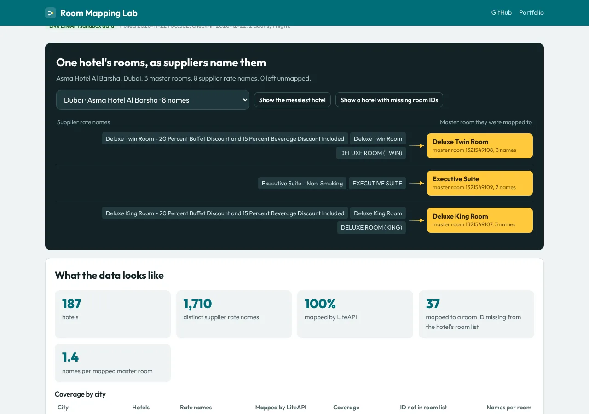

# Room Mapping Lab

**Supplier room names against master rooms from the LiteAPI sandbox: three matching methods tested against LiteAPI's own mapping, and the confidence threshold turned into a business decision.**

**Current version:** 0.2.0

Live: https://kostasxeras.com/room-mapping-lab/



## The question

Every hotel supplier names the same room differently. Mapping those names to one master room is what makes rates comparable, so a traveller sees one room with the best price instead of five confusing ones. The hard part is not matching, it is deciding how much to automate: every threshold trades automation against wrong rooms booked and review work. I built this lab to make that trade-off concrete on real LiteAPI data.

## Who it is for

- Mapping and content product teams deciding how much matching to automate
- Engineering leads weighing rules, models and LLMs for entity matching
- Hiring managers who want to see product judgement connected to business outcomes

## What is inside

- **The problem**: coverage by city, names per master room, and one hotel up close with its supplier names grouped by master room and the unmapped ones in red
- **Three matching methods**: rules (room class, bed, view, extras, with abbreviations such as DBL, TWN, DLX), character trigram similarity, and a hybrid that is confident only when both agree
- **Scored against LiteAPI's mapping**, with the share auto-mapped and the agreement at a confidence threshold
- **Data checks**: rates mapped to room IDs missing from content, accessible rates mapped to non-accessible rooms, duplicate master rooms, mapping consistency and destination search
- **Disagreements and suggestions**: where a method disagrees with LiteAPI, and what the hybrid would suggest for rates LiteAPI left unmapped
- **The decision**: a threshold slider, business inputs (volume, review capacity, review cost, booking share, cost of a wrong room, value of a mapped name), net value by threshold and the best threshold
- **Sensitivity**: how the best threshold moves when the cost of a wrong room or review capacity change
- **A one-page operating plan**: metrics, the first 90 days, trade-offs for engineering, and the decision to ask for
- **Data job**: a GitHub Action pulls the data from the LiteAPI sandbox with a key kept as a repository secret

## Main findings

Full detail in the [case study](docs/case-study.md).

- **Simple methods agree with LiteAPI's mapping on most names, but not enough to automate everything** (confirmed on sandbox data, 22 November 2026). On 1,710 distinct rate names from 187 hotels in 8 cities, the hybrid method and text similarity picked the same master room as LiteAPI for 85% of names, rules for 65%. At a confidence of 0.8 the hybrid would auto-map 62% of names with 94% agreement.
- **Whole hotels point to room IDs that are not in their room list** (confirmed on sandbox data, cause is a hypothesis). In 3 of 187 hotels, all in Barcelona, every rate (37 names) is mapped to a room ID missing from the hotel's content room list. Because it is all rates in each hotel, it looks like a per-hotel ID mismatch between rate mapping and content, not a matching error.
- **Some accessible rates are mapped to rooms not marked accessible** (confirmed on sandbox data). Of 73 mapped rate names that mention accessibility, 4 (in 4 New York hotels) are mapped to a room with no accessibility marker, although each hotel has accessible rooms in its list. Small in number, high in cost per error.
- **Duplicate master rooms in content** (confirmed on sandbox data). 45 extra copies of a master room name across 24 hotels, for example the same room name twice in one hotel. Rates for one room can split across the copies.
- **Destination search: the first result for "Rome" is Rome, Georgia** (confirmed on sandbox data). The places endpoint returned 5 candidates for "Rome" and the first was Rome, GA, USA. My first pull took the first result and got 11 hotels in Georgia. The fetch now picks the candidate in the expected country.
- **Clean on consistency, and no coverage gap in the sandbox** (confirmed on sandbox data). No supplier name maps to two different rooms within one hotel. Every rate returned had a mapping, so the real unmapped share needs production data: [to measure].
- **The best threshold depends on business inputs, not only on the model** (design finding). With the example inputs, the best threshold is 0.85. Halving the cost of a wrong room moves it to 0.35, doubling it moves it to 0.90.

## Data and sources

Live data comes from the LiteAPI sandbox through scripts/fetch_liteapi.py, run by a GitHub Action with the LITEAPI_KEY repository secret: master rooms from /data/hotel and rate names with mappedRoomId from /hotels/rates with room mapping on, for up to 25 hotels in each of 8 cities. Until that file exists, the page uses data/sample.json, a small hand-written sample in the same shape, clearly labelled on the page as not LiteAPI data. The reference is LiteAPI's own mapping, not a hand-checked truth. Business inputs are examples, not Nuitée figures. Nuitée is not involved in this project.

## Decisions

- [LiteAPI's mapping as the reference, not the truth](docs/decisions/0001-reference-not-truth.md)
- [Treat the threshold as a business decision](docs/decisions/0002-threshold-as-business-decision.md)
- [No LLM judge in the first version](docs/decisions/0003-no-llm-in-v0.md)
- [The API key lives in a GitHub secret](docs/decisions/0004-key-in-actions.md)

## How I would measure success

These are the measures I would run a mapping product on.

| Measure | Definition | Target |
|---|---|---|
| Correct-mapping share | Share of bookable rates mapped correctly, weighted by bookings (from an audit sample) | [target] |
| Coverage | Share of rate names mapped, by city and supplier | [target] |
| Time to map | Hours from a new hotel or supplier to 95% coverage | [target] |
| Guardrail | Wrong-room complaints and refunds per 10,000 bookings | [target] |

## What I would do next

1. Add a per-hotel integrity check for mapped room IDs missing from the content room list
2. Add an LLM judge for the uncertain slice and measure accuracy, cost and latency
3. Hand-label an audit sample to measure precision against truth, not agreement
4. Thresholds per room risk class (suites and views stricter than simple doubles)

## How it was built

I framed the problem, made the product calls and wrote the conclusions. Claude (Anthropic) was my engineering partner for the code. 

## Run it yourself

One HTML page with no build step. Open `index.html` through any local web server, for example `python3 -m http.server`, then go to http://localhost:8000.

## Repo layout

```
index.html                     The lab
app.css                        Shared base styles
data/live.json                 LiteAPI sandbox data (written by the fetch job)
data/sample.json               Hand-written sample, used until live data exists
scripts/fetch_liteapi.py       Pulls rates, mapping and master rooms
scripts/screenshots.py         Screenshots for the README
.github/workflows/             Fetch, screenshots and release jobs
docs/                          Brief, case study, decisions, screenshots
```
